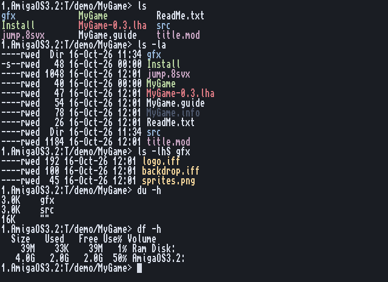

# CUtils

Unix-style commands for AmigaOS 3.2, in C: the core utils your fingers already
know, one small pure program each, made for `C:` and for csh pipes.

- **46 commands** - files, text, archives, the system, the network, the manual.
- **The Amiga's way where it matters**: `Work:dir/file` paths, `#?` and `*`
  patterns, protection bits (`hsparwed`), filenotes and dates kept on every
  copy, move and pack; no "insert volume" requesters.
- **Careful by default**: cp and mv never replace a file without `-f`, rm never
  deletes a drawer without `-r` or a volume ever, a broken copy leaves no half file.
- **Made for pipes**: colours only in a window, plain text into a file or a pipe,
  so `ls | wc -l` and `grep -l x #? | xargs rm` work.
- **Replaces some of C:** - `date`, `sort` and `which` still take the Amiga's own
  templates, so scripts written for the originals keep working.
- **A manual page for each**: `man NAME`, or `NAME ?` for the usage line.

## The commands

Each name links to its manual page; each group to a page with examples and pictures.

### [Files and drawers](docs/guide/files.md)

| | |
|---|---|
| [ls](man/english/CUtils/ls.md) | drawers in columns, coloured by kind; long form, sorted by size or date |
| [cp](man/english/CUtils/cp.md) | copy files and trees; never over a file unless `-f` |
| [mv](man/english/CUtils/mv.md) | move or rename; trees across volumes all or nothing |
| [rm](man/english/CUtils/rm.md) | delete; drawers only with `-r`, volumes never |
| [mkdir](man/english/CUtils/mkdir.md) | make drawers, `-p` for a whole path |
| [ln](man/english/CUtils/ln.md) | hard and soft links |
| [touch](man/english/CUtils/touch.md) | date a file now, or make it |
| [chmod](man/english/CUtils/chmod.md) | protection bits, Unix style (`+x`, `755`) and the Amiga's (`+s`, `=rwed`) |
| [stat](man/english/CUtils/stat.md) | all about a file: type, size, bits, date, filenote |
| [file](man/english/CUtils/file.md) | what a file really is: programs, icons, IFF, MODs, archives, ADFs |
| [find](man/english/CUtils/find.md) | walk trees: by name, type, size, age; `-exec`, `-delete` |
| [du](man/english/CUtils/du.md) | how big trees are |
| [df](man/english/CUtils/df.md) | how full the volumes are |
| [basename](man/english/CUtils/basename.md), [dirname](man/english/CUtils/dirname.md) | the parts of a path, the Amiga way |

### [Text](docs/guide/text.md)

| | |
|---|---|
| [cat](man/english/CUtils/cat.md) | files one after another |
| [head](man/english/CUtils/head.md), [tail](man/english/CUtils/tail.md) | the start or the end; `tail -f` follows a log |
| [grep](man/english/CUtils/grep.md) | lines that match, matches in colour |
| [sed](man/english/CUtils/sed.md) | the stream editor, GNU sed's whole language |
| [cut](man/english/CUtils/cut.md) | columns and characters out of lines |
| [tr](man/english/CUtils/tr.md) | change, delete or squeeze characters (Latin-1 aware) |
| [sort](man/english/CUtils/sort.md) | lines in order; also C:Sort's template |
| [uniq](man/english/CUtils/uniq.md) | runs of equal lines once, or counted |
| [wc](man/english/CUtils/wc.md) | lines, words, bytes |
| [diff](man/english/CUtils/diff.md) | what changed between two files or trees, coloured like git |
| [tee](man/english/CUtils/tee.md) | save what goes through a pipe |
| [xargs](man/english/CUtils/xargs.md) | build commands from a list of names |
| [seq](man/english/CUtils/seq.md) | count, for scripts |

### [Archives and packing](docs/guide/archives.md)

| | |
|---|---|
| [tar](man/english/CUtils/tar.md) | GNU tar: create, list, unpack; any squeezed kind found by itself |
| [gzip](man/english/CUtils/gzip.md), [gunzip](man/english/CUtils/gunzip.md) | pack and unpack gzip |
| [bzip2](man/english/CUtils/bzip2.md), [bunzip2](man/english/CUtils/bunzip2.md) | pack and unpack bzip2 |
| [unxz](man/english/CUtils/unxz.md) | unpack xz |
| [unzstd](man/english/CUtils/unzstd.md) | unpack zstd |

### [The system](docs/guide/system.md)

| | |
|---|---|
| [ps](man/english/CUtils/ps.md) | the Shells and what they run, or every task, with stack headroom |
| [kill](man/english/CUtils/kill.md) | send a break, by Shell number, address or name |
| [top](man/english/CUtils/top.md) | the classic top: tasks by CPU, measured exactly |
| [ctop](man/english/CUtils/ctop.md) | btop for the Amiga: CPU, memory, disks, network, tasks, in graphs |
| [free](man/english/CUtils/free.md) | chip and fast memory, and the largest block |
| [uptime](man/english/CUtils/uptime.md) | how long since the last start |
| [date](man/english/CUtils/date.md) | the date, or set the clock; also `+FORMAT` (replaces C:Date) |
| [which](man/english/CUtils/which.md) | where a command is found (replaces C:Which) |

### [The network](docs/guide/network.md)

| | |
|---|---|
| [wget](man/english/CUtils/wget.md) | fetch files over http and https (AmiSSL 5), resumes, retries |

### [The manual](docs/guide/man.md)

| | |
|---|---|
| [man](man/english/CUtils/man.md) | manual pages: ours (Markdown), Unix ones (roff), the system's own, AmigaGuide |

## What it needs

- **AmigaOS 3.2** or later, any 68020 or better.
- `wget https://` needs AmiSSL 5 (and about 4 MB free fast RAM). `ctop` draws its graphs
  in braille in CTerm, in ASCII in any other console window.
- Nothing else: no ixemul, no libnix shared library, no assigns but `MAN:` for man.

## Installing

Copy the commands into `C:`, and the manual pages where man looks for them:

    Copy bin/#? C:
    MakeDir HELP:Man HELP:Man/english
    Copy man/english/CUtils HELP:Man/english/CUtils ALL
    Assign MAN: HELP:Man                  (also in S:User-Startup)

- **Put them in `C:`, not in a drawer added at the end of the path.** Some names are
  taken further up: Workbench's `SYS:System/Find` comes before a `find` added with
  `Path ... ADD`, and `C:Which`, `C:Date` and `C:Sort` before CUtils' own. To keep the
  Amiga's originals, rename them first (`Rename C:Sort C:Sort-amiga`). CUtils' `date`,
  `sort` and `which` take the originals' templates too.
- The commands are pure (`-resident32`): `Resident C:ls PURE` keeps one in memory.

## State

Beta, version 0.1 to 0.3 per command (`version C:ls`). All 46 are installed in `C:` on
an A1200 (PiStorm, Emu68, OS 3.2.3) and pass their test cases in FS-UAE
(`tests/run.sh`). Some are also checked against the real thing: sed against GNU
sed, tar against GNU tar, sort against C:Sort, wget against aminet.net over https.

**Known bugs** are in [TODO.md](TODO.md). The worst: `tar` can crash the machine when it
creates an archive on the default 4 KB Shell stack. Until that is fixed, give it more
first: `Stack 32768`.

## Building and testing

    make                 builds bin/*, with bebbo's m68k-amigaos-gcc
    tests/run.sh         the cases in tests/cases/ on a private FS-UAE
    tests/uae030.sh      a 68030 FS-UAE with AmiSSL, for wget's https cases
    tests/sed-pc/run.sh  sed.c against GNU sed on Linux, and the 68020 build under vamos

How the commands are built, and the rules every one keeps:
[docs/design.md](docs/design.md). The bigger ones have their own design notes:
[tar and the squeezers](docs/tar.md), [man](docs/man.md), [ctop](docs/ctop.md).
`man/` holds the manual pages of every program, not only CUtils' ([man/README.md](man/README.md)).

## The Amiga E versions

`e/` holds the earlier CUtils in Amiga E (ls cp mv mkdir rm, and vinstall), moved here
from [AmigaTools](https://github.com/creep-ltx/AmigaTools) with their history. Their
releases (ls 0.3.4, cp 0.1.2, mv 0.5, mkdir 0.1.1, rm 0.1) stay on AmigaTools' release
page. The C versions replace them.

## License

MIT, see [LICENSE](LICENSE).
