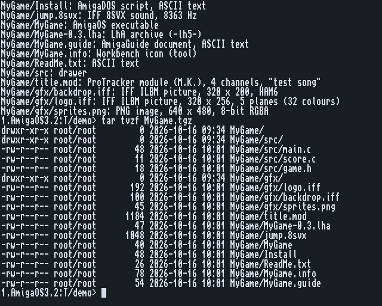

# Archives and packing

tar, gzip, gunzip, bzip2, bunzip2, unxz, unzstd.
Back to the [README](../../README.md).

## Two jobs

**tar bundles** files and drawers into one stream, with their names, dates and
protection bits; it does not make them smaller. **A squeezer** (gzip, bzip2, xz, zstd)
makes one stream smaller. A `.tar.gz` is both.

## tar

GNU tar's command and format: an archive made here unpacks on Linux, macOS and Windows,
and theirs unpack here. `c` creates, `x` unpacks, `t` lists, bundled the way everyone
types them:

    tar czvf RAM:project.tgz Work:Project     create, gzip
    tar cjf RAM:project.tar.bz2 Work:Project  create, bzip2
    tar tvf download.tar.xz                   list
    tar xf download.tar.zst -C RAM:           unpack into RAM:

- **Reading** takes v7, ustar, GNU (long names and links) and pax archives, plain or
  squeezed with gzip, bzip2, xz or zstd. The kind is found from the first bytes, never
  from the name, so `tar xf` unpacks any of them.
- **Creating** makes plain, gzip (`z`) and bzip2 (`j`) archives.
- **The Amiga's own** is kept: protection bits, filenotes, soft and hard links (as pax
  `AMIGA.protect` / `AMIGA.comment`, which other tars pass over).
- **Safe unpacking**: nothing is ever written outside the drawer. Leading `/`, volume
  names and anything up to a `..` are taken off the names (and said), and soft links are
  made last, so no member can be written through one. A file that is there is replaced,
  unless it is delete-protected or `-k` is given.

## The squeezers

| | packs | unpacks | memory |
|---|---|---|---|
| gzip / gunzip | yes (`-1` to `-9`) | yes, every member's CRC and length checked | 400 KB packing, 110 KB unpacking |
| bzip2 / bunzip2 | yes | yes, every block's CRC | 7.6 MB packing at `-9` (less by itself for small files), 3.7 MB unpacking, or 2.3 MB in small mode when memory is short |
| unxz | no | yes, CRC32, CRC64 and SHA-256, BCJ filters | the file's window: 8 MB for `xz -6`, grown only as needed |
| unzstd | no | yes, frame checksums | the file's window, up to 128 MB |

They work as GNU's do: `gzip file` replaces it with `file.gz` (with the old one's date,
bits and filenote), `-d` unpacks, `-c` writes to the output, `-k` keeps the original.
With no file they pack their input, so they sit in pipes:

    tar cf - Work:Project | gzip >RAM:project.tar.gz
    gunzip <notes.gz | more

There is no xz or zstd packer on the Amiga yet: pack with gzip or bzip2.

Every option of every command: its manual page, `man NAME`. How tar and the squeezers
were designed and measured: [docs/tar.md](../tar.md).
