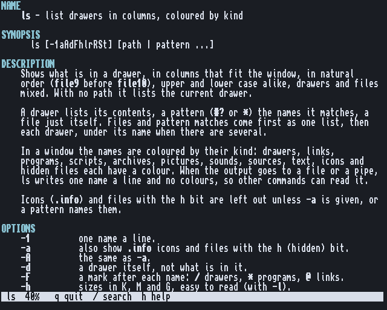

# The manual

man. Back to the [README](../../README.md).

**man NAME** shows a manual page. In a window it opens in its own viewer: scroll, `/` to
search, `h` for help, `q` to quit. Into a file or a pipe the page comes out as plain
text, so `man ls | grep -i sort` works.

## Where the pages come from

man looks in this order, and the first one found wins:

    MAN:LANG/PROGRAM/NAME.md       pages installed for programs (NAME.1 ... NAME.9: Unix pages)
    HELP:LANG/Sys/DRAWER/NAME.help the system's own pages (AmigaOS 3.2 has 110 of them)
    the same two in english
    NAME.guide or NAME.doc         next to the program, or in HELP:

LANG is the language chosen in Locale prefs. **MAN:** is an assign, usually to
`HELP:Man`. Add pages of your own with `Assign MAN: Work:MyPages ADD` and put them in
`Work:MyPages/english/Mine/NAME.md`.

## What it reads

- **Markdown** (`.md`), the form of CUtils' own pages (they are in
  [man/english/CUtils](../../man/english/CUtils) and read as well on GitHub as on the Amiga).
- **Unix man pages** (roff, the man(7) macros), so a ported tool's manual works as it is.
- **Plain text** in the Amiga's manual form (NAME, FORMAT, TEMPLATE...): the system's own.
- **AmigaGuide** and `.doc` files.

`man -k WORD` searches the names and descriptions of every page, `man -a` shows every page
of a name in turn, `man -w` only says where the page is.

`man/` in this repository holds the pages for the user's other programs too (CShell,
CTerm, Sumi, Ahiru, Wasabi...): [man/README.md](../../man/README.md). The page format and
man's design: [docs/man.md](../man.md).
