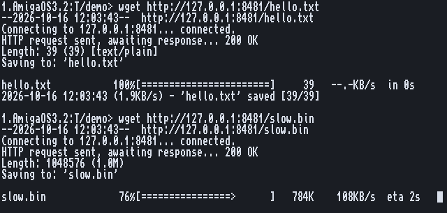

# The network

wget. Back to the [README](../../README.md).

**wget** downloads what each URL points to into the current drawer, named after the last
part of the URL, as GNU wget does (`name.1`, `name.2` when the name is taken):

    wget https://aminet.net/util/arc/untgz.lha
    wget -c http://example.com/big.lha          go on where a broken download stopped
    wget -O RAM:page.html http://example.com/
    wget -i RAM:urls.txt                        every URL in a file

- **HTTP/1.1**, plain and **https** with AmiSSL 5 (certificates checked against
  `AmiSSL:Certs`; AmiSSL is opened only for https, so http works without it).
- **Redirects** (up to 20, also to another server or to https), chunked answers,
  answers with no length, `user:password@` logins. The file gets the server's date.
- **Retries**: a lost connection, a silent server (`-T` seconds) or an answer of 500 and
  up is tried again (3 tries), going on from where it stopped when the server allows.
  A 404 is said once, and a failed URL never stops the others.
- **The progress line** is redrawn in place: name, percent, a bar, bytes, speed, time
  left, fitted to the window. Into a file, a line per MB.
- **Ctrl-C** stops at once and keeps the part already fetched, for `wget -c` later.

https needs about 4 MB of free fast memory for AmiSSL.

Every option: its manual page, `man wget`.
