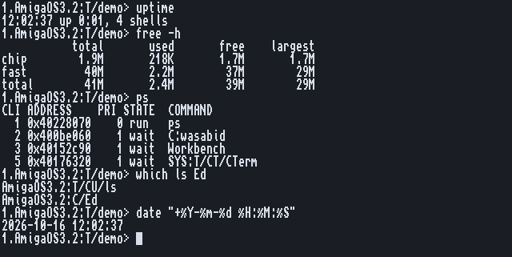
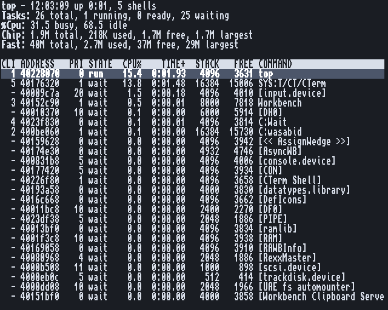
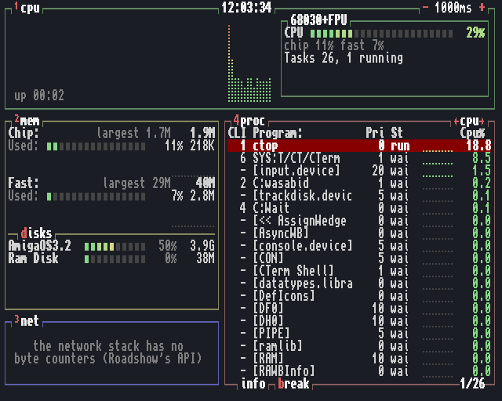

# The system

ps, kill, top, ctop, free, uptime, date, which.
Back to the [README](../../README.md).

## Tasks: ps and kill

**ps** shows the Shells and what each runs now, as Status does but easier to read:
the Shell's number, the task's address, priority, state (run, ready, wait) and the
command. `-e` shows every task (devices, handlers, Workbench), `-l` adds the stack and
how much of it is still free. That is the column to watch: a task with almost no free
stack is about to crash.

**kill** sends a break, the same as Ctrl-C in the program's window, to a Shell number,
a task's address (`0x...`), or a name, as pkill does (patterns work):

    kill 3              the command running in Shell 3
    kill wget           Ctrl-C to every wget
    kill -D 4           Ctrl-D to Shell 4's command
    kill "#?bench#?"

## Watching: top and ctop

**top** is the classic Unix top, inside the terminal (a CTerm tab or any console
window): time and uptime, task counts, CPU busy and idle, chip and fast memory with the
largest block, then every task, the busiest first, with CPU%, TIME+, stack size and free
stack. The CPU times are **measured, not sampled**: top hooks exec's task switches and
counts the E-clock for each, so even a task that runs for a moment is caught. On a PiStorm
the CPU line also shows Emu68's 68k MIPS. Into a pipe, top prints one list and ends
(`top | grep wget`).

**ctop** is btop for the Amiga, in four boxes, each switched on and off with its number
key: **cpu** (a history graph, meter, MIPS and, on a PiStorm, the Pi's temperature and
clock), **mem** (chip and fast with graphs, every volume with a meter), **net** (bytes in
and out a second, from the network stack's own counters), **proc** (every task with a
small CPU graph each). It fits itself to the window, from a 40 x 12 Shell window up. In
CTerm the graphs are braille dots in 256 colours; any other console gets ASCII. `-d 0.5`
refreshes twice a second.

(In FS-UAE the net box says the network stack has no byte counters: the emulated
bsdsocket has none. On a real Amiga with lwip-amiga or Roadshow it shows the traffic.)

## Memory and time: free, uptime, date

**free** shows chip memory (what the custom chips can see), fast memory and both,
with the largest free block: memory broken into small pieces is free but of little use,
and that column shows it. `-h`, `-k`, `-m` for the units.

**uptime** counts from the last reset by the E-clock: `21:45:20 up 2 days, 1:02, 3 shells`.

**date** replaces C:Date: with no words it prints the date as Date does, in your Locale's
words, and the Amiga form (`date 16-Oct-26 12:00`) sets the clock as before. A first word
starting with `+` or `-` is the Unix form, for scripts: `date "+%Y-%m-%d"`.

## Where is it: which

**which** replaces C:Which, with the same output and keywords (`NORES`, `RES`, `ALL`),
and looks where the Shell looks, in its order: the resident list, the current drawer,
the path, C:. `which -a` lists every place.

Every option of every command: its manual page, `man NAME`. ctop's design and its
measurements: [docs/ctop.md](../ctop.md).
