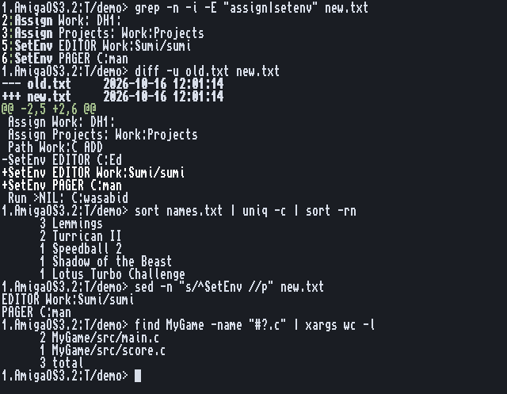

# Text

cat, head, tail, grep, sed, cut, tr, sort, uniq, wc, diff, tee, xargs, seq.
Back to the [README](../../README.md).

## Made for pipes

Every text command reads files, or its input when no file is given (or `-`), and
writes to its output. They are at their best joined with `|` in csh, and work with `<`
and `>` in the ROM Shell. In a window grep and diff colour their output; into a pipe or a
file it is plain text.

    List | grep .info | wc -l
    sort names.txt | uniq -c | sort -rn
    grep -l TODO #?.c | xargs sed -i "s/TODO/FIXME/g"
    find Work:Projects -name "#?.c" | xargs wc -l

**Quoting**: in csh, quote as in bash (`cut -d' ' -f1`, `grep "a.*b"`). In the ROM Shell and
in AmigaDOS scripts a quote counts only at the start of a word, and inside quotes `*` is the
escape character: write `cut -d " " -f1` and `grep "a.**b"` there.

Text is bytes in Latin-1, the Amiga's own character set: `tr [:upper:] [:lower:]`,
`grep -i` and `sort -f` know the accented letters too.

## Looking

**cat** joins files as they are (fast, safe for any file); `-n` numbers the lines.
**head** and **tail** show the start or the end; `tail` reads big files from the end,
so the last lines come at once, and `tail -f` keeps showing what is added to a log.
**wc** counts lines, words and bytes, and with one count asked for prints the number
alone, for scripts: `List | wc -l`.

## Finding: grep

GNU grep's regular expressions: basic by default, `-E` for extended (`"cat|dog"`), `-F`
for plain text. The options people use every day are all there: `-i -v -w -n -c -l -o -r`,
and context with `-A -B -C`.

    grep -n -i assign S:Startup-Sequence
    grep -r -l "OpenLibrary" Work:Projects
    grep -E -o "[0-9]+ bytes" log.txt

## Changing: sed, tr, cut

**sed** is GNU sed's whole language: `s y d D p P n N g G h H x b t T a i c r R w W = l q
Q`, every address form (`3`, `$`, `/re/I`, `1~3`, `/a/,/b/`, `5,+2`, `0,/re/`), `\U \L` in
replacements, `-i` to change files in place. It is tested against GNU sed on Linux, so
scripts from books and the net work as they are.

    sed -n "s/^SetEnv //p" S:User-Startup
    sed -i.bak "/^;/d" S:User-Startup
    sed "1~2s/^/> /" file

**tr** changes, deletes or squeezes characters (`tr -s " "`, `tr -d \r`, ranges and
classes). **cut** takes columns (`-f` with `-d`) or characters (`-c`) out of each line.

## Ordering and counting: sort, uniq

**sort** knows numbers (`-n`, `-h` for 1K 2M, `-V` for versions), keys (`-k 2,2 -t ,`),
reverse, unique. It replaces C:Sort: `sort FROM a TO b NUMERIC` still works.
**uniq** writes runs of equal lines once; `-c` counts them, `-d` only the repeated ones.

## Comparing: diff

Two files or two drawers. The normal form, or `-u` unified as patch and git use, coloured
like git in a window (removed red, added green, `@@` cyan). `-r` goes through drawers,
`-q` only says whether they differ, `-w -b -B -i` ignore white space, blank lines, case.

    diff -u S:User-Startup.bak S:User-Startup
    diff -r -q Work:Project Work:Project-old

## Glue: tee, xargs, seq

**tee** saves what goes through a pipe and passes it on. **xargs** turns a list of names
into command lines (`-n`, `-I {}`, `-0` with `find -print0`), and never runs the command
with no words. **seq** counts, also down and in decimals, for scripts.

    List | tee RAM:list | grep foo
    seq 1 5 | xargs -I {} echo "pass {}"

Every option of every command: its manual page, `man NAME`.
